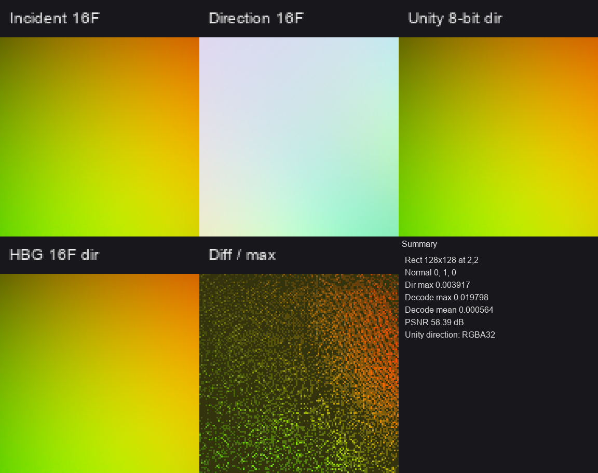
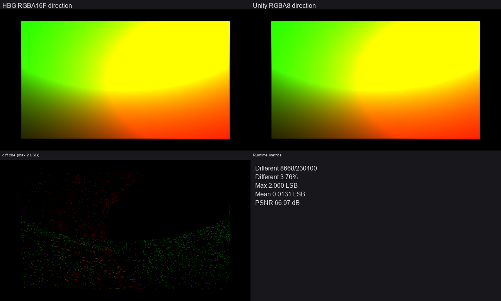

# Dawn GI D7.8：Unity 线性 8-bit 参考模型同场景对比

> 状态：**部分完成 / Unity Editor 实机截图阻塞**。  
> 本机未安装可用的 Unity Editor，无法在 Unity 中重烘并截取 Game View。当前报告对比的是**同一份官方 Dawn.exe T2 烘焙结果**在 Unity 导入/解码语义与 HBG 运行时之间的差异；这不是 Unity Editor 实机截图，不能替代 D0.12。方向贴图的导入色彩空间已按原版代码与 Unity 生成的 `DirectionalLightmap` 资源收敛（线性采样有强证据）；PNG 导出字节路径和实机画面仍待 Editor 验证。

## 1. 结论

- 原版方向贴图最终以 **RGBA32 PNG** 导出，并按默认路径以 `TextureImporterType.DirectionalLightmap`（type 12）导入；Unity 生成的该类型资源 meta 为 `sRGBTexture: 0`，支持运行时线性采样。HBG 的 `IncidentLighting + SHVectorR` 解码方向、颜色分布和 Unity `SampleDirectionalLightmap` 一致；未发现 UV V 翻转、颜色通道互换或方向轴错误。
- 可测量的差异来自原版 Unity 导入器把方向贴图写成 `TextureFormat.RGBA32`（每通道 8-bit），而 HBG DDS 三层均为 RGBA16F。T2 的 128×128 区域：
  - 方向编码最大误差 `0.0039168`（约 1 个 8-bit LSB），平均 `0.0019541`。
  - 解码辐亮度最大绝对差 `0.0197983`，平均 `0.0005640`，RMSE `0.0018473`，PSNR **58.39 dB**。
  - 最大相对差 `0.3776%`（位于红光源峰值附近）。
- 用 Unity 8-bit 方向量化重建 DDS 后，640×360 D3D11 runtime lightmap 截图仅 **8,668 / 230,400（3.76%）** 像素不同，最大差 **2 个 8-bit LSB**，只有 **1** 个像素超过 1 LSB；PSNR **66.97 dB**。这属于正常量化误差，不是方向或解码错误。
- 因此，**线性 8-bit 参考模型对比通过**，且 `DirectionalLightmap` 的线性采样分支已由 Unity 资源 meta 支持；但 PNG `SetPixels/EncodeToPNG` 的 CPU 字节路径、以及 Unity Editor 实烘截图仍未验证，D7.8 不能据此签字。

## 2. 对比对象与限制

### 2.1 已完成的部分

- 场景：D7.1 T2，4m×4m 白地板、UV2 `u=x/v=z`、`128×128` lightmap、atlas `2048`、rect `[2,2]`、`texelPerUnit=32`、方向贴图开启。
- 光源：`+X` 红灯 `(2.5,2,0)`、`+Z` 绿灯 `(0,2,2.5)`，`intensity=24`、`range=7`、无阴影；另有 0.01 黑天空。
- 烘焙：官方 `Dawn.exe` + 本地 Coordinator/Deamon/Agent 路径实际产出 `v2.00000000000000000000000000000005.lmgz`，`128×128 = 16,384` samples。
- 参考：原版 Unity 导入器语义 + Unity `SampleDirectionalLightmap` 公式；方向按线性 8-bit 采样建模。原版实际导出路径为 `DawnBakingResult.cs:479` 的 `.png`，导入类型为 `TextureImporterType.DirectionalLightmap`（`:534`）。
- 运行时：HBG D3D11 `--debug-view=lightmap`，640×360，3 帧，使用相同 `.lmgz` 生成的 2048 atlas DDS。

### 2.2 未完成的部分

- **没有 Unity Editor 实机烘焙/截图**。本机 `E:\Learn\Unity\Learn` 的 `ProjectVersion.txt` 为 `2021.3.8f1c1`，但没有找到对应的 Unity Editor；`D:\Soft\Unity Hub\Editor` 也不存在。原版 Dawn 插件未安装到该项目。
- 因此，Unity 侧的 RGBM/HDR 导入、Unity 相机曝光/后处理、Unity Game View 的实际显示未参与对比。
- 原版 `DawnEncodeTextures.cs:149` 使用 `new Texture2D(..., TextureFormat.RGBA32, false)`；第 4 个参数是 `mipChain`，不是 `linear`。该源 `Texture2D` 省略了 `linear`，默认是 sRGB 标记；但它只作为 CPU 像素容器，最终经 `DawnBakingResult.cs:479,527-534` 导出 `.png` 并以 `TextureImporterType.DirectionalLightmap` 重新导入。按 Dawn 默认无 `DirectionalMapImporterSettings` preset 的路径，Unity 的该类型资源 meta（本机 Unity 生成示例：`E:\Learn\Graphics\Tests\SRPTests\Projects\UniversalGraphicsTest_Lighting\Assets\Scenes\155_ReflectionProbes_BoxProjection\Lightmap-0_comp_dir.png.meta`）显示 `textureType: 12`、`sRGBTexture: 0`；原版 `DawnBakingResult.SetTextureImportSettings` 只在 `Default`/`SingleChannel` 分支显式写 `sRGBTexture=false`，`DirectionalLightmap` 依赖 Unity 类型默认。该证据支持线性模型，但 `textureType` setter 是否在所有 Unity 版本自动落 `sRGBTexture=false` 仍需 Editor 确认。若项目显式配置了 DirectionalMap Importer preset，则需单独核对 preset。另需注意：正常路径在 `SetTextureImportSettings` 前先 `AssetDatabase.ImportAsset` 生成 Importer（`DawnBakingResult.cs:589-593`），但 `Importer == null` 的 fallback `UpdateTextureMetaFile`（`:396-430`）只改 `textureType`/`maxTextureSize`/`textureCompression`，不写 `sRGBTexture`；若走到该 fallback，sRGB 会留给默认 PNG 导入设置。
- 仍需 Editor 验证：`Texture2D.SetPixels` → `EncodeToPNG` 是否原样保留 8-bit 方向字节（当前模型假设保留），以及 Unity Game View 的实际显示。
- D0.12（Unity 官方 golden）仍阻塞；D7.8 不能只凭本报告标记为完全完成。

## 3. 原版代码依据

| 行为 | 原版位置 | 结论 |
|---|---|---|
| 颜色贴图 | `DawnEncodeTextures.cs:148` | `TextureFormat.RGBAHalf`，线性/HDR 路径不额外 gamma |
| 方向贴图 | `DawnEncodeTextures.cs:149` | `TextureFormat.RGBA32`，每通道 8-bit；第 4 参数 `false` 是 `mipChain` |
| 方向导出 | `DawnBakingResult.cs:479,527-534` | 方向纹理导出 `.png`，登记为 `TextureImporterType.DirectionalLightmap` |
| 导入类型 | `UnityCsReference ...TextureImporterEnums.cs` | `DirectionalLightmap = 12` |
| 导入色彩空间 | 本机 Unity 生成的 `Lightmap-*_comp_dir.png.meta` | `textureType: 12`，`sRGBTexture: 0`，按线性采样模型 |
| Incident 读入 | `DawnLightmap2DImporter.cs:47-57` | `IncidentLighting` → color texels |
| SHVectorR 读入 | `DawnLightmap2DImporter.cs:64-78` | `SHVectorR` → direction texels |
| 块写入 | `DawnEncodeTextures.cs:399,408` | `SetPixels(EncodeOffset, Width, Height, ...)` |
| 编码 | `DawnEncodeTextures.cs:457-475` | 颜色 alpha 固定 1；方向保留四分量 |
| Unity 解码 | `EntityLighting.hlsl`（core 12.1.7）`:328-358` | `illuminance * (dot(n, dir.xyz-0.5)+0.5) / max(1e-4, dir.w)` |
| HBG 运行时 | `shaders/lighting/baked_gi.sc:8-21` | 同一公式，额外 `max(..., 0)` |
| HBG DDS | `tools/dawnbake/src/lightmap_dds.cpp` | 三层统一 RGBA16F |

## 4. 对比方法

### 4.1 参考路径

对同一份 T2 `.lmgz` 生成 atlas DDS 后：

1. 读取 `lm0_sh0.dds`（Incident）与 `lm0_sh1.dds`（SHVectorR）。
2. 颜色保持 RGBA16F。
3. 方向按原版 RGBA32 PNG 路径建模为 `floor(clamp(x,0,1) * 255) / 255`，包括 directionality（alpha）；当前假设 PNG 往返原样保留这 8-bit 值。
4. 按 `DirectionalLightmap` 资源 meta 的 `sRGBTexture: 0` 使用线性采样模型；再用 `SampleDirectionalLightmap` 公式在法线 `+Y` 上解码。
5. 与 HBG 原始 RGBA16F 方向的解码结果逐 texel 比较。

> 关键修正：原版方向纹理不是直接以 RGBA32 参与运行时，而是先写 PNG、再按 `DirectionalLightmap` 重新导入；本模型对齐的是这条导入路径的 8-bit 数值。按 Unity 资源 meta，sRGB 采样分支大概率不适用；但 type setter 默认和 PNG CPU 字节是否严格原样保留仍需 Unity Editor 复核。

### 4.2 运行时路径

- 原版与 unity-quantized 方向各生成一套 atlas DDS；场景、相机、材质、分辨率、帧数相同。
- D3D11 `--debug-view=lightmap` 截图后逐像素比较。
- 复现命令见 §7。

## 5. 数据

### 5.1 T1 单平行光标定（D7.2 实烘）

| 项 | HBG / Dawn | Unity 8-bit 方向参考 | 差 |
|---|---:|---:|---:|
| `IncidentLighting` | (1.000254, 1.000254, 1.000254) | 同左（RGBAHalf） | 0 |
| `SHVectorR` | (0.499861, 0.999723, 0.499861, 1.000254) | (0.498039, 0.996078, 0.498039, 1.000000) | 编码 ≤0.003917 |
| 解码 `+Y` | (0.999723, 0.999723, 0.999723) | (0.996331, 0.996331, 0.996331) | 0.003392（0.339%） |

结论：T1 白色/方向正确；按线性 8-bit 参考模型，Unity 方向量化在该样本上造成 0.339% 亮度差；PNG 字节路径尚未在 Unity Editor 验证。

### 5.2 T2 关键采样点

坐标基于 `rect [2,2,128,128]` 内的局部像素坐标。

| 采样点 | HBG RGBA16F 解码 | Unity 8-bit 方向解码 | 最大通道差 |
|---|---:|---:|---:|
| 中心 `(64,64)` | (1.350586, 1.357422, 0) | (1.350586, 1.357422, 0) | ~1.2e-7 |
| 右侧 `(112,64)` | (4.259354, 0.945764, 0) | (4.261719, 0.946289, 0) | 0.002365 |
| 上方 `(64,16)` | (0.968120, 0.376708, 0) | (0.968750, 0.376953, 0) | 0.000629 |
| 红灯峰 `(127,63)` | (5.370314, 0.741489, 0) | (5.378906, 0.742676, 0) | 0.008592 |
| 绿灯峰 `(64,127)` | (0.730835, 5.397233, 0) | (0.730469, 5.394531, 0) | 0.002701 |
| 最大差像素 `(126,69)` | (5.243280, 0.855498, 0) | (5.223481, 0.852268, 0) | **0.019798** |

### 5.3 整体指标

| 指标 | 值 |
|---|---:|
| 方向编码最大误差 | 0.0039168 |
| 方向编码平均误差 | 0.0019541 |
| 解码最大绝对差 | 0.0197983 |
| 解码平均绝对差 | 0.0005640 |
| 解码 RMSE | 0.0018473 |
| 解码 PSNR | **58.39 dB** |
| 解码差 > 1/255 的 texel | 8.88% |
| runtime 不同像素 | 8,668 / 230,400（3.76%） |
| runtime 最大差 | 2 个 8-bit LSB |
| runtime 超过 1 LSB 的像素 | 1 |
| runtime PSNR | **66.97 dB** |

完整 JSON：`docs/images/dawn-d78/metrics.json`。

## 6. 图

### 6.1 贴图空间对比



- 上排：`IncidentLighting`、`SHVectorR`、Unity RGBA32 方向解码。
- 下排：HBG RGBA16F 方向解码、绝对差 / 最大值、摘要。
- 红色峰值靠近右下，绿色峰值靠近左下，和 `+X` 红、`+Z` 绿一致；差值没有结构性形状，只有量化噪声。

### 6.2 运行时对比



- 左：HBG 原始 RGBA16F 方向；右：Unity 8-bit 量化方向。
- 下排：差 ×64 放大（最大 2 LSB，仅 1 个像素超过 1 LSB）与统计。
- 该 640×360 HBG 截图与 D7.2 的 `t2_new_640.png` 逐字节一致（0 diff），说明运行时路径可复现。

## 7. 复现

```powershell
# 1. 同场景导出与官方 Dawn 实烘（D7.1/D7.6 路径）
.\build\vs2022\tools\dawnbake\Debug\hbg_dawnbake.exe --export-t2 out\t2 22222222333333334444444455555555
.\build\vs2022\tools\dawnbake\Debug\hbg_dawnbake.exe --bake out\t2 22222222333333334444444455555555 `
  --agent http://127.0.0.1:5009 --dawn <Dawn.exe> --timeout 1200

# 2. 生成 atlas DDS
.\build\vs2022\tools\dawnbake\Debug\hbg_dawnbake.exe --write-lightmap-dds `
  out\t2\v2.00000000000000000000000000000005.lmgz out\t2 2048 2 2

# 3. 参考对比（可附加两张同尺寸 runtime PNG）
py -3 tools\dawnbake\unity_reference_compare.py `
  --dds-dir out\t2 --rect 2 2 128 128 --normal 0 1 0 `
  --write-unity-dds out\t2_unity --write-unity-png out\t2_unity_png `
  --runtime-a <hbg_640.png> --runtime-b <unity_quantized_640.png> `
  --out docs\images\dawn-d78

# 4. 运行时截图（相机/场景见 D7.1 的 t2_runtime.gltf）
.\build\vs2022\Debug\hbg.exe --backend=d3d11 `
  --render-test=<t2_runtime.gltf> --frames=3 --width=640 --height=360 `
  --no-debug-ui --debug-view=lightmap --screenshot=<out.png>
```

`unity_reference_compare.py` 只读取 `lm<N>_sh0/1/2.dds`，不重新烘焙；它负责 Unity 8-bit 方向量化（可选 `--write-unity-dds` 输出量化后的 DDS，`--write-unity-png` 输出与原版导出路径一致的 8-bit 方向 PNG）、Unity 解码公式、贴图/运行时对比图和 JSON 指标。运行时 `t2_runtime.gltf` 是 D7.1 侧车与 T2 网格/相机的验证 fixture，不属于 `.lmgz` 协议输出。

## 8. 偏差与后续

- **方向精度**：HBG 为 RGBA16F，Unity 原版是 RGBA32。按 `Color32` 截断模型，runtime 最大差 2 LSB、仅 1 个像素超过 1 LSB；不建议为了“看起来一样”主动降到 8-bit。
- **方向纹理色彩空间（采样分支有强证据）**：原版 4 参数 `Texture2D` 构造中的 `false` 是 `mipChain`；方向纹理导出 PNG 后以 `TextureImporterType.DirectionalLightmap` 重新导入，Unity 该类型资源 meta 为 `sRGBTexture: 0`。线性采样分支有强证据，但原版未显式覆盖该类型 sRGB，依赖 Unity type setter 默认；仍需 Editor 验证 `SetPixels/EncodeToPNG` 是否原样保留 8-bit 字节和最终画面。
- **原版可改进点（不在本仓库修改）**：`DirectionalLightmap` 分支和 `UpdateTextureMetaFile` fallback 都建议显式写 `sRGBTexture=false`，避免依赖 Unity 版本/type setter 默认；当前对比假设该值为 0。
- **负半 Lambert**：Unity `SampleDirectionalLightmap` 不裁剪负值；HBG `baked_gi.sc` 最终 `max(...,0)`。T1/T2 的 +Y 法线不触发该分支，背面/反向法线尚未对比。
- **采样器 wrap**：原版 `Texture2D` 未显式设置 wrap/filter，HBG 使用 `BGFX_SAMPLER_UVW_CLAMP`；D7.5 padding 覆盖了 rect 内边界，rect 外行为未纳入本轮。
- **Unity Editor 实机**：需要 2021.3.8f1c1 + Dawn 2.4.5，重烘 T2 并截 Game View；之后把 Unity 截图作为第三张图加入本报告，才能关闭 D0.12/D7.8。
